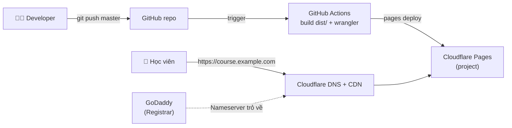

# Triển khai website khoá học lên Cloudflare Pages bằng GitHub Actions

Tài liệu hướng dẫn deploy repository **aws-cloud-for-beginner-v2** (website tĩnh HTML/CSS/JS) lên **Cloudflare Pages**, tự động hoá bằng **GitHub Actions**, sử dụng tên miền đang quản lý tại **GoDaddy**.

---

## 1. Kiến trúc tổng quan



- **GoDaddy**: chỉ giữ vai trò nhà đăng ký (registrar) tên miền.
- **Cloudflare DNS**: quản lý DNS, SSL, CDN.
- **Cloudflare Pages**: host file tĩnh.
- **GitHub Actions**: mỗi lần push lên `master` → đóng gói các file cần thiết vào `dist/` → upload lên Cloudflare Pages bằng `wrangler`.
  Pull Request sẽ được deploy thành **Preview URL** riêng để review trước khi merge.

### Vì sao không deploy toàn bộ repo?

Repo có ~193MB, trong đó `slide_old/` (~144MB) và `source_code_old/` (~11MB) là tài liệu cũ, không cần public. Workflow chỉ copy các file website cần thiết (~35MB, ~900 file) — nằm thoải mái trong giới hạn của Cloudflare Pages (tối đa 20.000 file, mỗi file ≤ 25MB).

| Deploy | Không deploy |
|---|---|
| `index.html`, `welcome.html`, `styles.css`, `script.js`, `mermaid-config.js`, `prism.css`, `prism.js` | `slide_old/`, `source_code_old/` |
| `sections/`, `assets/`, `images/`, `sourcecode/`, `mermaid/` | `CLAUDE.md`, `outline.md`, `Diagram.drawio`, `startserver.py`, `infra-cicd/`, `.git/` |

---

## 2. Yêu cầu trước khi bắt đầu

- Tài khoản **Cloudflare** (gói Free là đủ).
- Quyền admin tên miền trên **GoDaddy**.
- Quyền admin repo GitHub `hoanglinhdigital/aws-cloud-for-beginner-v2` (để thêm Secrets/Variables).
- (Tuỳ chọn) Node.js ≥ 20 trên máy local nếu muốn chạy `wrangler` thủ công.

Trong tài liệu này dùng tên miền ví dụ `example.com` và subdomain `course.example.com` — thay bằng tên miền thật của bạn.

---

## 3. Bước 1 — Chuyển DNS của tên miền từ GoDaddy sang Cloudflare

> Có 2 lựa chọn. **Khuyến nghị lựa chọn A** (chuyển nameserver) vì hỗ trợ cả apex domain (`example.com`), SSL tự động và CDN đầy đủ.

### Lựa chọn A (khuyến nghị): Đổi Nameserver sang Cloudflare

1. **Thêm site vào Cloudflare**
   - Cloudflare Dashboard → **Add a domain** → nhập `example.com` → chọn plan **Free**.
   - Cloudflare sẽ tự quét (import) các DNS record hiện có trên GoDaddy.

2. **Kiểm tra lại DNS record đã import**
   - Đối chiếu với DNS trên GoDaddy, đặc biệt các record quan trọng:
     - `MX`, `TXT` (SPF/DKIM/DMARC) — nếu đang dùng email theo tên miền (Google Workspace, Zoho...).
     - `CNAME`/`A` của các dịch vụ khác đang chạy.
   - Thiếu record nào thì thêm thủ công trước khi đổi nameserver, tránh gián đoạn email/dịch vụ.

3. **Tắt DNSSEC trên GoDaddy (nếu đang bật)**
   - GoDaddy → Domain → **DNS** → **DNSSEC** → tắt.
   - Nếu không tắt, tên miền có thể không resolve được sau khi đổi nameserver.

4. **Đổi Nameserver trên GoDaddy**
   - Cloudflare sẽ cung cấp 2 nameserver dạng `xxx.ns.cloudflare.com` và `yyy.ns.cloudflare.com`.
   - GoDaddy → My Products → Domain → **DNS** → **Nameservers** → **Change Nameservers** → chọn *I'll use my own nameservers* → nhập 2 nameserver của Cloudflare → Save.

5. **Chờ kích hoạt**
   - Thường mất vài phút đến vài giờ (tối đa 24–48h). Cloudflare sẽ gửi email khi domain chuyển sang trạng thái **Active**.
   - Kiểm tra từ máy local:

   ```bash
   dig NS example.com +short
   ```

   Kết quả mong đợi là 2 nameserver `*.ns.cloudflare.com`.

6. (Tuỳ chọn) Bật lại **DNSSEC** trong Cloudflare (DNS → Settings → DNSSEC), sau đó thêm bản ghi DS mà Cloudflare cung cấp vào GoDaddy.

### Lựa chọn B: Giữ DNS ở GoDaddy (chỉ dùng subdomain)

Nếu không muốn chuyển nameserver, có thể dùng **subdomain** (ví dụ `course.example.com`) bằng cách tạo bản ghi `CNAME` trên GoDaddy trỏ về `<project-name>.pages.dev` (chi tiết ở Bước 6).
Hạn chế: **không dùng được apex domain** (`example.com`) và không tận dụng được các tính năng DNS/WAF của Cloudflare.

---

## 4. Bước 2 — Tạo Cloudflare Pages project

Tạo project kiểu **Direct Upload** (deploy do GitHub Actions đẩy lên, không dùng Git integration của Cloudflare).

**Cách 1 — Dashboard:**
- Workers & Pages → **Create** → tab **Pages** → **Upload assets** (Direct Upload).
- Project name: `aws-cloud-for-beginner` (tên này sẽ thành `aws-cloud-for-beginner.pages.dev`).
- Có thể upload tạm 1 file `index.html` bất kỳ để tạo project, lần deploy sau từ CI sẽ ghi đè.
- Settings → **Production branch**: `master`.

**Cách 2 — Wrangler CLI (từ máy local):**

```bash
npx wrangler login
npx wrangler pages project create aws-cloud-for-beginner --production-branch=master
```

> ⚠️ Project phải được tạo **trước** khi chạy workflow. Nếu chưa có, `wrangler pages deploy` trong CI sẽ lỗi vì không thể hỏi tương tác.

---

## 5. Bước 3 — Tạo API Token và lấy Account ID

### 5.1 API Token

Cloudflare Dashboard → My Profile → **API Tokens** → **Create Token** → **Create Custom Token**:

| Mục | Giá trị |
|---|---|
| Token name | `github-actions-pages-deploy` |
| Permissions | **Account** → **Cloudflare Pages** → **Edit** |
| Account Resources | Include → *tài khoản của bạn* |
| TTL | Tuỳ chọn (khuyến nghị đặt ngày hết hạn và rotate định kỳ) |

Copy token ngay (chỉ hiển thị 1 lần).

> Nguyên tắc **least privilege**: token chỉ cần quyền Cloudflare Pages Edit. Không dùng Global API Key.

### 5.2 Account ID

Cloudflare Dashboard → Workers & Pages → cột bên phải **Account ID** (hoặc trong URL `dash.cloudflare.com/<ACCOUNT_ID>/...`).

---

## 6. Bước 4 — Cấu hình GitHub Secrets & Variables

GitHub repo → **Settings** → **Secrets and variables** → **Actions**:

**Secrets** (tab *Secrets*):

| Tên | Giá trị |
|---|---|
| `CLOUDFLARE_API_TOKEN` | Token tạo ở Bước 3 |
| `CLOUDFLARE_ACCOUNT_ID` | Account ID |

**Variables** (tab *Variables*):

| Tên | Giá trị |
|---|---|
| `CF_PAGES_PROJECT` | `aws-cloud-for-beginner` |

Hoặc dùng GitHub CLI:

```bash
gh secret set CLOUDFLARE_API_TOKEN
gh secret set CLOUDFLARE_ACCOUNT_ID
gh variable set CF_PAGES_PROJECT --body "aws-cloud-for-beginner"
```

---

## 7. Bước 5 — Tạo GitHub Actions workflow

### 7.1 (Tuỳ chọn) File `_headers` — cấu hình cache & security header

Tạo file `infra-cicd/_headers` (workflow sẽ copy vào `dist/`):

```text
/*
  X-Content-Type-Options: nosniff
  Referrer-Policy: strict-origin-when-cross-origin
  X-Frame-Options: SAMEORIGIN

/assets/*
  Cache-Control: public, max-age=604800

/images/*
  Cache-Control: public, max-age=604800

/*.css
  Cache-Control: public, max-age=3600

/*.js
  Cache-Control: public, max-age=3600
```

> `X-Frame-Options: SAMEORIGIN` vẫn cho phép `index.html` load chapter trong iframe vì cùng origin.
> CSS/JS để cache ngắn (1 giờ) vì tên file không có hash — sau khi deploy, học viên sẽ nhận bản mới trong tối đa 1 giờ. Cloudflare Pages tự purge cache CDN khi deploy mới.

### 7.2 Workflow file

Tạo file `.github/workflows/deploy-cloudflare-pages.yml`:

```yaml
name: Deploy to Cloudflare Pages

on:
  push:
    branches: [master]
  pull_request:
    branches: [master]
  workflow_dispatch:

permissions:
  contents: read
  deployments: write
  pull-requests: write

concurrency:
  group: cloudflare-pages-${{ github.ref }}
  cancel-in-progress: true

jobs:
  deploy:
    name: Build & Deploy
    runs-on: ubuntu-latest
    # PR từ fork không có quyền đọc secrets → bỏ qua để tránh fail
    if: github.event_name != 'pull_request' || github.event.pull_request.head.repo.full_name == github.repository
    environment:
      name: ${{ github.event_name == 'pull_request' && 'preview' || 'production' }}
      url: ${{ steps.deploy.outputs.deployment-url }}

    steps:
      - name: Checkout
        uses: actions/checkout@v4

      - name: Build dist (chỉ copy file website)
        run: |
          set -euo pipefail
          rm -rf dist && mkdir -p dist
          cp index.html welcome.html styles.css script.js mermaid-config.js prism.css prism.js dist/
          cp -r sections assets images sourcecode mermaid dist/
          if [ -f infra-cicd/_headers ]; then cp infra-cicd/_headers dist/_headers; fi
          echo "Files: $(find dist -type f | wc -l)  Size: $(du -sh dist | cut -f1)"

      - name: Deploy to Cloudflare Pages
        id: deploy
        uses: cloudflare/wrangler-action@v3
        with:
          apiToken: ${{ secrets.CLOUDFLARE_API_TOKEN }}
          accountId: ${{ secrets.CLOUDFLARE_ACCOUNT_ID }}
          command: >-
            pages deploy dist
            --project-name=${{ vars.CF_PAGES_PROJECT }}
            --branch=${{ github.head_ref || github.ref_name }}
            --commit-hash=${{ github.event.pull_request.head.sha || github.sha }}
            --commit-dirty=true

      - name: Comment preview URL on PR
        if: github.event_name == 'pull_request'
        uses: actions/github-script@v7
        with:
          script: |
            await github.rest.issues.createComment({
              owner: context.repo.owner,
              repo: context.repo.repo,
              issue_number: context.issue.number,
              body: `🚀 Preview deployed: ${{ steps.deploy.outputs.deployment-url }}`
            });
```

Giải thích:
- `--branch=master` → Cloudflare hiểu là **Production deployment** (vì production branch của project là `master`).
- Branch khác (PR) → **Preview deployment** tại URL dạng `https://<hash>.aws-cloud-for-beginner.pages.dev`.
- `concurrency` đảm bảo không có 2 deploy chạy chồng lên nhau trên cùng branch.

### 7.3 Commit & push

```bash
git checkout -b feature/cloudflare-cicd
git add .github/workflows/deploy-cloudflare-pages.yml infra-cicd/_headers infra-cicd/Cloudflare-deployment.md
git commit -m "ci: deploy website to Cloudflare Pages via GitHub Actions"
git push -u origin feature/cloudflare-cicd
```

Tạo Pull Request → workflow chạy và comment Preview URL. Kiểm tra OK → merge vào `master` → deploy Production.

---

## 8. Bước 6 — Gắn custom domain

Cloudflare Dashboard → Workers & Pages → project `aws-cloud-for-beginner` → **Custom domains** → **Set up a custom domain**.

### Nếu dùng Lựa chọn A (DNS đã ở Cloudflare)

- Nhập `course.example.com` (hoặc apex `example.com`) → Cloudflare tự tạo bản ghi `CNAME` và cấp SSL.
- Nếu muốn cả `example.com` và `www.example.com`: thêm cả 2 custom domain, sau đó tạo **Redirect Rule** (Rules → Redirect Rules) chuyển `www` → apex (301).

### Nếu dùng Lựa chọn B (DNS vẫn ở GoDaddy)

1. Trong Cloudflare Pages: thêm custom domain `course.example.com` → Cloudflare hiển thị hướng dẫn tạo CNAME.
2. Trên GoDaddy DNS, thêm record:

   | Type | Name | Value | TTL |
   |---|---|---|---|
   | CNAME | `course` | `aws-cloud-for-beginner.pages.dev` | 1 Hour |

3. Quay lại Cloudflare Pages → **Check DNS records** → chờ trạng thái **Active** (SSL được cấp tự động).

> ⚠️ Phải thêm custom domain trong Cloudflare Pages **trước** (hoặc ngay sau) khi tạo CNAME. Nếu chỉ tạo CNAME mà không đăng ký trong Pages sẽ gặp lỗi `522`/`1014`.

---

## 9. Kiểm tra kết quả

- GitHub → tab **Actions**: workflow `Deploy to Cloudflare Pages` có trạng thái ✅.
- Cloudflare → project → **Deployments**: thấy deployment Production gắn commit mới nhất.
- Kiểm tra từ máy local:

```bash
dig course.example.com +short
curl -I https://course.example.com/
curl -I https://course.example.com/sections/section_1/chapter_1.html
curl -I https://course.example.com/slide_old/
```

Mong đợi:
- 2 lệnh `curl` đầu trả về `HTTP/2 200`, có header `server: cloudflare`.
- `slide_old/` **không** trả về nội dung (đã loại khỏi bản deploy).
- Mở trình duyệt: sidebar click chapter load đúng trong iframe, Mermaid diagram render, Prism highlight hoạt động.

---

## 10. Rollback

Cloudflare → project → **Deployments** → chọn deployment cũ → **Rollback to this deployment**. Có hiệu lực ngay, không cần chạy lại CI.

Hoặc rollback qua Git (khuyến nghị để giữ lịch sử nhất quán):

```bash
git revert <commit-hash>
git push origin master
```

---

## 11. Troubleshoot

| Lỗi | Nguyên nhân | Giải pháp |
|---|---|---|
| `Authentication error [code: 10000]` | Token sai, hết hạn hoặc thiếu quyền | Tạo lại token với quyền **Account → Cloudflare Pages → Edit**, cập nhật secret `CLOUDFLARE_API_TOKEN` |
| `Project not found [code: 8000007]` | Chưa tạo project hoặc sai `CF_PAGES_PROJECT` | Tạo project ở Bước 2, kiểm tra lại tên trong Variables |
| Deploy thành công nhưng là **Preview** thay vì Production | Production branch của project không phải `master` | Project → Settings → Builds & deployments → Production branch = `master` |
| Workflow PR fail ở bước deploy (PR từ fork) | Fork không đọc được secrets | Đã có điều kiện `if` bỏ qua; người có quyền repo tạo branch nội bộ để test |
| Domain không resolve sau khi đổi nameserver | DNSSEC còn bật trên GoDaddy, hoặc chưa propagate | Tắt DNSSEC trên GoDaddy, chờ thêm; kiểm tra `dig NS example.com +short` |
| Email theo tên miền ngừng hoạt động | Thiếu bản ghi `MX`/`TXT` khi chuyển DNS | Thêm lại `MX`, SPF, DKIM, DMARC trong Cloudflare DNS |
| `ERR_TOO_MANY_REDIRECTS` | Redirect Rule lặp hoặc SSL mode `Flexible` kết hợp redirect | SSL/TLS mode để **Full (strict)**, kiểm tra lại Redirect Rules |
| Lỗi `522` / `1014` trên custom domain | CNAME đã tạo nhưng domain chưa được thêm vào Pages project | Thêm custom domain trong Pages → Custom domains |
| Trang chapter 404, CSS không load | Thiếu thư mục/file trong bước `Build dist` | Bổ sung đường dẫn vào lệnh `cp` của workflow (VD: thêm thư mục mới) |
| Sửa CSS/JS nhưng trình duyệt vẫn thấy bản cũ | Browser cache (`max-age=3600`) | Hard refresh (Ctrl+Shift+R) hoặc giảm `max-age` trong `_headers` |

---

## 12. Chi phí & bảo mật

- **Cloudflare Pages Free**: không giới hạn bandwidth/request cho static asset, 500 build/tháng (ở đây build chạy trên GitHub Actions nên không tính), tối đa 100 custom domain/project.
- **GitHub Actions**: repo public miễn phí; repo private dùng quota 2.000 phút/tháng (gói Free) — mỗi lần deploy chỉ mất ~1 phút.
- **GoDaddy**: chỉ trả phí gia hạn tên miền như bình thường.
- Bảo mật:
  - Không commit token vào repo; chỉ lưu trong GitHub Secrets.
  - Đặt ngày hết hạn cho API token và rotate định kỳ.
  - (Tuỳ chọn) Bật **Branch protection** cho `master` (yêu cầu PR + review) để tránh deploy ngoài ý muốn.
  - (Tuỳ chọn) Dùng GitHub **Environments** `production` với *Required reviewers* để duyệt thủ công trước khi deploy Production.
  - (Tuỳ chọn) Nếu muốn giới hạn truy cập Preview deployment: Project → Settings → **Access policy** (Cloudflare Access) cho `*.aws-cloud-for-beginner.pages.dev`.

---

## 13. Checklist tóm tắt

- [ ] Thêm domain vào Cloudflare, kiểm tra DNS record đã import (MX/TXT)
- [ ] Tắt DNSSEC trên GoDaddy, đổi nameserver sang Cloudflare, chờ **Active**
- [ ] Tạo Pages project `aws-cloud-for-beginner`, production branch `master`
- [ ] Tạo API token (Cloudflare Pages: Edit), lấy Account ID
- [ ] Thêm `CLOUDFLARE_API_TOKEN`, `CLOUDFLARE_ACCOUNT_ID` (Secrets), `CF_PAGES_PROJECT` (Variable)
- [ ] Thêm `.github/workflows/deploy-cloudflare-pages.yml` và `infra-cicd/_headers`
- [ ] Tạo PR → kiểm tra Preview URL → merge vào `master`
- [ ] Gắn custom domain trong Pages project, kiểm tra HTTPS
